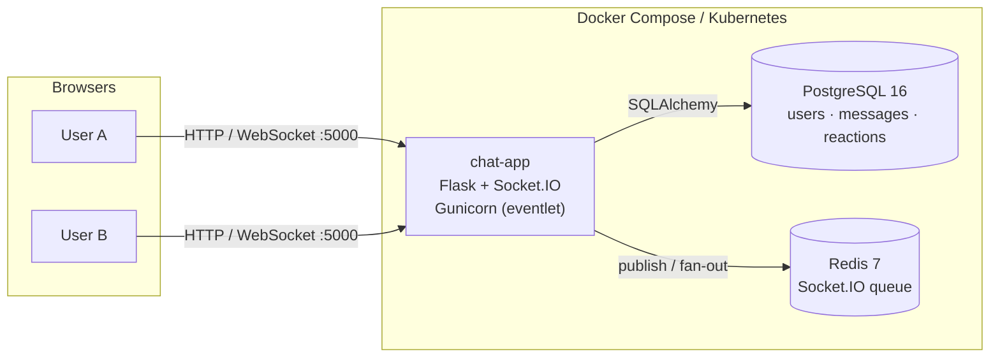

# ChatSpace — Real-Time Messaging App

ChatSpace is a real-time messaging application built with **Flask + Socket.IO**, backed by **PostgreSQL**, and scaled with **Redis** as the Socket.IO message queue.

The application supports real-time group and direct messaging, user presence, reactions, mentions, file sharing, authentication, Docker deployment, and Kubernetes deployment.

It includes:

* Docker support with `Dockerfile` and `docker-compose.yml`
* Kubernetes manifests in `k8k/`
* PostgreSQL for persistent data
* Redis for Socket.IO message distribution
* Support for running multiple application replicas

---

## ✨ Features

* 💬 Real-time group chat using Socket.IO
* 👤 Direct 1-to-1 messaging
* 🔔 `@username` mentions with desktop notifications
* 😀 Emoji reactions on messages
* ✏️ Message editing and deletion by the author
* ⌨️ Typing indicators
* 🟢 Live online-user list
* 📊 User presence/status updates
* 👤 User profiles with:

  * Bio
  * Email
  * Avatar upload
* 📎 File sharing in chat

  * PNG
  * JPG/JPEG
  * PDF
  * TXT
  * Maximum size: 5 MB
* 🔐 Secure authentication

  * Werkzeug password hashing
  * Server-side sessions
* ⚡ Redis-backed Socket.IO message queue
* 🐳 Dockerized deployment
* ☸️ Kubernetes deployment manifests
* 🔒 Non-root Docker user and container health checks

---

## 🧰 Tech Stack

| Layer             | Technology                                                          |
| ----------------- | ------------------------------------------------------------------- |
| Backend           | Python 3.11 · Flask 3.1 · Flask-SocketIO 5.6 · Flask-SQLAlchemy 3.1 |
| Database          | PostgreSQL 16 · psycopg2                                            |
| Message Queue     | Redis 7                                                             |
| Production Server | Gunicorn 23 · Eventlet                                              |
| Frontend          | Jinja2 · Bootstrap 4 · jQuery · Socket.IO JavaScript Client         |
| Containerization  | Docker · Docker Compose                                             |
| Deployment        | Kubernetes · kind                                                   |

---

## 🏗️ Architecture



---

## 📁 Project Structure

```text
.
├── app.py                     # Flask app, routes, Socket.IO events and DB models
├── requirements.txt
├── Dockerfile                 # Python 3.11-slim, non-root user and healthcheck
├── docker-compose.yml         # App + PostgreSQL + Redis
├── .env                       # Local secrets (gitignored)
│
├── templates/
│   ├── login.html
│   ├── register.html
│   └── dashboard.html         # Chat UI and Socket.IO client
│
├── uploads/                   # Avatars and shared files (gitignored)
├── chat-app.tar               # Saved image for loading into kind (gitignored)
│
├── instance/
│   └── app.db                 # Leftover SQLite database from older version
│
└── k8k/
    ├── base/
    │   ├── deployment
    │   ├── services
    │   ├── postgres StatefulSet
    │   ├── redis
    │   └── secret
    │
    └── overlays/
        ├── dev/
        └── prod/
```

> **Note:** `instance/app.db` is a leftover SQLite database from an older version and can safely be deleted.

---

# 🚀 Quick Start — Docker Compose

## 1. Create the `.env` file

Create a `.env` file in the project root:

```env
SECRET_KEY=<random-hex-string>

POSTGRES_USER=chatuser
POSTGRES_PASSWORD=<strong-password>
POSTGRES_DB=chatapp
```

> Never commit real credentials or secrets to Git.

---

## 2. Build and start the application

```bash
docker compose up -d --build
```

This starts:

* `chat-app` — Flask application on port `5000`
* `chat-db` — PostgreSQL 16 with persistent `pgdata` volume
* `chat-redis` — Redis 7

---

## 3. Open the application

Visit:

```text
http://localhost:5000
```

Register a user, log in, and start chatting.

To test real-time messaging, open the application in a second browser profile or window.

---

## Stop / Reset

Stop the containers while keeping the database:

```bash
docker compose down
```

Stop the containers and delete the database volume:

```bash
docker compose down -v
```

---

# 💻 Local Development

You can also run ChatSpace without Docker.

## Prerequisites

* Python 3.11+
* PostgreSQL
* Redis

---

## 1. Create a virtual environment

### Windows PowerShell

```powershell
python -m venv venv
venv\Scripts\Activate.ps1
```

---

## 2. Install dependencies

```powershell
pip install -r requirements.txt
```

---

## 3. Configure environment variables

```powershell
$env:SECRET_KEY = "dev_secret_key"

$env:POSTGRES_USER = "postgres"
$env:POSTGRES_PASSWORD = "postgres"
$env:POSTGRES_HOST = "localhost"
$env:POSTGRES_PORT = "5432"
$env:POSTGRES_DB = "chatapp"

$env:REDIS_URL = "redis://localhost:6379/0"
```

---

## 4. Run the application

```powershell
python app.py
```

The application will be available at:

```text
http://localhost:5000
```

Database tables are automatically created on startup using:

```python
db.create_all()
```

---

# ☸️ Kubernetes Deployment

ChatSpace includes Kubernetes manifests designed to work with **kind**.

The deployment expects the following Docker image:

```text
chatspacereal-timemessagingapp-app:latest
```

---

## 1. Build the Docker image

```bash
docker build -t chatspacereal-timemessagingapp-app:latest .
```

---

## 2. Create a kind cluster

```bash
kind create cluster --name chatspace
```

---

## 3. Load the image into kind

Using the kind CLI:

```bash
kind load docker-image chatspacereal-timemessagingapp-app:latest --name chatspace
```

### Alternative method

If the kind CLI is unavailable, save and import the image manually.

```bash
docker save -o chat-app.tar chatspacereal-timemessagingapp-app:latest

docker cp chat-app.tar desktop-control-plane:/chat-app.tar

docker exec desktop-control-plane \
    ctr --namespace=k8s.io images import /chat-app.tar
```

> Adjust the node name if necessary. You can find the node name using `docker ps`.

---

## 4. Configure credentials

Edit:

```text
k8k/base/secret.yml
```

Replace the placeholder values for:

* `SECRET_KEY`
* `POSTGRES_USER`
* `POSTGRES_PASSWORD`
* `POSTGRES_DB`

The PostgreSQL StatefulSet and application both use the Kubernetes Secret:

```text
chat-secrets
```

---

## 5. Deploy ChatSpace

```bash
kubectl apply -f k8k/base/
```

This creates the following Kubernetes resources:

| Resource       | Kind        | Purpose                                                       |
| -------------- | ----------- | ------------------------------------------------------------- |
| `chat`         | Deployment  | Application pod with init containers for PostgreSQL and Redis |
| `chat-app`     | Service     | NodePort `30080` → container port `5000`                      |
| `postgres`     | StatefulSet | PostgreSQL 16 with 2 Gi persistent volume                     |
| `postgres`     | Service     | Headless service for PostgreSQL                               |
| `redis`        | Deployment  | Redis 7 with AOF persistence                                  |
| `redis`        | Service     | Redis ClusterIP on port `6379`                                |
| `chat-secrets` | Secret      | Application and database credentials                          |

---

## 6. Verify the deployment

Check the pods:

```bash
kubectl get pods
```

Check the services:

```bash
kubectl get svc
```

View application logs:

```bash
kubectl logs -f deploy/chat
```

All application, PostgreSQL, and Redis pods should eventually reach:

```text
Running
```

and:

```text
1/1 Ready
```

---

## 7. Access the application

kind does not expose NodePorts to the host by default.

Use port forwarding:

```bash
kubectl port-forward svc/chat-app 5000:80
```

Then open:

```text
http://localhost:5000
```

Keep the port-forwarding terminal running while accessing the application.

On a cluster with routable nodes, the application can instead be accessed using:

```text
http://<node-ip>:30080
```

---

# ⚙️ Configuration

ChatSpace uses environment variables for configuration.

| Variable            | Description                 | Default                    |
| ------------------- | --------------------------- | -------------------------- |
| `SECRET_KEY`        | Flask session signing key   | `dev_secret_key`           |
| `POSTGRES_USER`     | PostgreSQL username         | `postgres`                 |
| `POSTGRES_PASSWORD` | PostgreSQL password         | `postgres`                 |
| `POSTGRES_HOST`     | PostgreSQL host             | `localhost`                |
| `POSTGRES_PORT`     | PostgreSQL port             | `5432`                     |
| `POSTGRES_DB`       | PostgreSQL database name    | `chatapp`                  |
| `REDIS_URL`         | Socket.IO message queue URL | `redis://localhost:6379/0` |

### Environment differences

Docker Compose uses:

```text
POSTGRES_HOST=db
```

Kubernetes uses:

```text
POSTGRES_HOST=postgres
```

and:

```text
REDIS_URL=redis://redis:6379/0
```

---

# 🌐 HTTP Endpoints

| Method   | Path              | Authentication | Description                           |
| -------- | ----------------- | -------------- | ------------------------------------- |
| GET      | `/`               | —              | Redirects to `/dashboard` or `/login` |
| GET/POST | `/login`          | —              | User login                            |
| GET/POST | `/register`       | —              | Create an account                     |
| GET      | `/dashboard`      | Required       | Chat interface                        |
| GET      | `/logout`         | —              | Clear session                         |
| GET/POST | `/profile`        | Required       | Bio, email and avatar                 |
| GET      | `/uploads/<file>` | —              | Serve uploaded files                  |
| POST     | `/edit_message`   | Author         | Edit own message                      |
| POST     | `/delete_message` | Author         | Delete own message                    |

---

# 🔌 Socket.IO Events

Socket.IO communication uses the:

```text
/chat
```

namespace.

## Client → Server

| Event            | Payload                   | Description                            |
| ---------------- | ------------------------- | -------------------------------------- |
| `message`        | `"text"`                  | Public message with `@mention` support |
| `direct_message` | `{ to, msg }`             | Send a 1-to-1 message                  |
| `typing`         | `{ typing: true/false }`  | Update typing indicator                |
| `react_message`  | `{ msg_id, emoji }`       | Toggle a reaction                      |
| `update_status`  | `{ status }`              | Update user presence                   |
| `file_message`   | `{ filename, file_data }` | Upload a Base64 data-URL file          |

---

## Server → Client

| Event               | Payload                                           | Description                           |
| ------------------- | ------------------------------------------------- | ------------------------------------- |
| `message`           | `{ msg_id, username, msg, timestamp, reactions }` | Public message                        |
| `direct_message`    | `{ from, to, msg, timestamp }`                    | Direct message                        |
| `file_message`      | `{ msg_id, username, filename, timestamp }`       | File message                          |
| `typing`            | `{ username, typing }`                            | Typing status                         |
| `reaction_updated`  | `{ msg_id, reactions }`                           | Updated reactions                     |
| `status_updated`    | `{ username, status }`                            | Updated presence status               |
| `mention`           | `{ from, msg }`                                   | Mention notification for online users |
| `user_connected`    | `{ username, online_count }`                      | User connected                        |
| `user_disconnected` | `{ username, online_count }`                      | User disconnected                     |

---

# 🗃️ Data Model

## User

The `User` model contains:

```text
id
username
password_hash
avatar
status
bio
email
```

* `username` is unique.
* `email` is unique and nullable.
* `status` defaults to `Online`.

---

## Message

The `Message` model contains:

```text
id
sender_id
receiver_id
content
timestamp
is_file
reactions
```

Relationships:

```text
sender_id → User
receiver_id → User
```

A `NULL` `receiver_id` represents a public-room message.

The `reactions` field stores JSON data in the form:

```text
emoji → [user_id]
```

The database schema is created at startup using:

```python
db.create_all()
```

There is currently no database migration system.

---

# 📎 File Uploads

ChatSpace supports the following file extensions:

```text
png
jpg
jpeg
pdf
txt
```

Maximum upload size:

```text
5 MB
```

Uploaded files are stored using the format:

```text
<uuid-hex>_<safe-filename>
```

Files are stored in:

```text
uploads/
```

and served through:

```text
/uploads/<filename>
```

The `uploads/` directory is gitignored.

---

# ⚠️ Known Limitations

## 1. Profile page is currently broken

The `/profile` route attempts to render:

```text
templates/profile.html
```

but this template does not currently exist.

As a result, visiting `/profile` returns HTTP `500`.

**Fix:** Add `profile.html` or remove the route.

---

## 2. Kustomize is not configured

The `k8k/base/` directory does not currently contain a `kustomization.yml`.

The following directories are also currently empty:

```text
k8k/overlays/dev/
k8k/overlays/prod/
```

For now, deploy using:

```bash
kubectl apply -f k8k/base/
```

---

## 3. Frontend functionality is incomplete

The backend supports:

* Direct messages
* Message editing
* Message deletion
* Reactions
* Status changes

However, these features are only partially wired into:

```text
dashboard.html
```

---

## 4. No database migrations

The project currently uses:

```python
db.create_all()
```

Model changes will not automatically modify existing database tables.

If the schema evolves, consider adding:

* Flask-Migrate
* Alembic

---

## 5. Single Gunicorn worker

The application uses a single Gunicorn worker because of the Eventlet + Socket.IO configuration.

For horizontal scaling, run multiple application replicas instead of increasing the number of workers.

Redis provides the Socket.IO message queue needed to distribute events between replicas.

---

## 6. Uploaded files are not persistent

The `uploads/` directory currently does not use a persistent volume in Docker Compose or Kubernetes.

Therefore, uploaded files can be lost when the container or Kubernetes pod is recreated.

---

# 🔒 Security Notes

* Passwords are stored using salted password hashes.
* Passwords are never stored as plaintext.
* `.env` is gitignored.
* `uploads/` is gitignored.
* `*.tar` files are gitignored.
* Never commit real credentials or secrets.
* `k8k/base/secret.yml` contains placeholders and must be configured before deployment.
* Production deployments should run behind TLS using an ingress or reverse proxy.
* If running multiple application replicas, use sticky sessions where required by the deployment configuration.

---

## 📄 License

No license is currently specified for this project.
